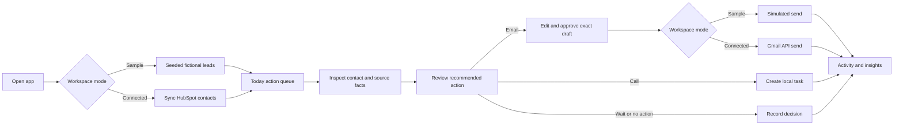
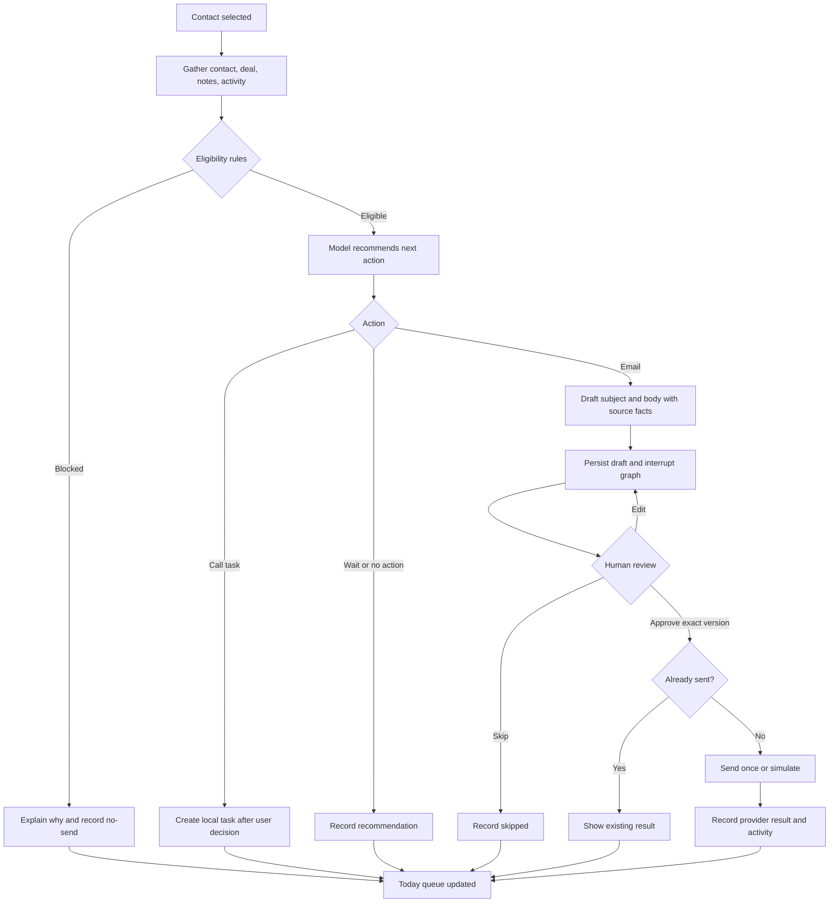
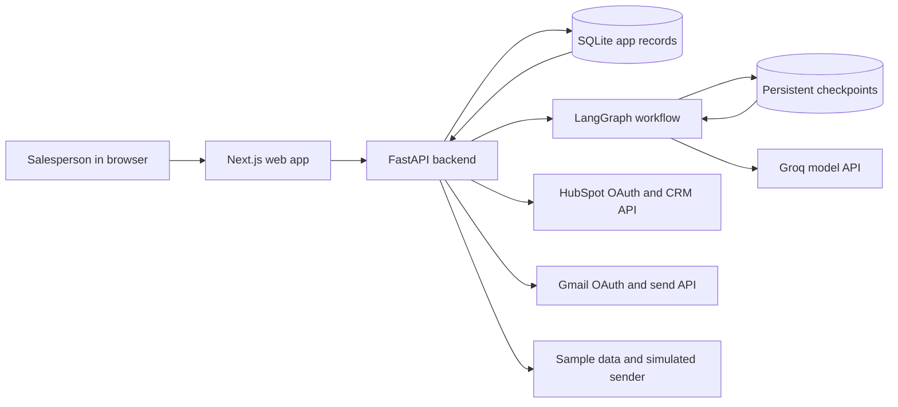
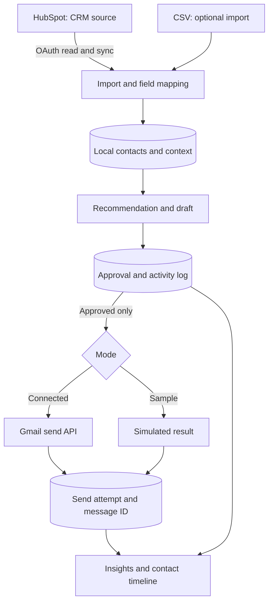
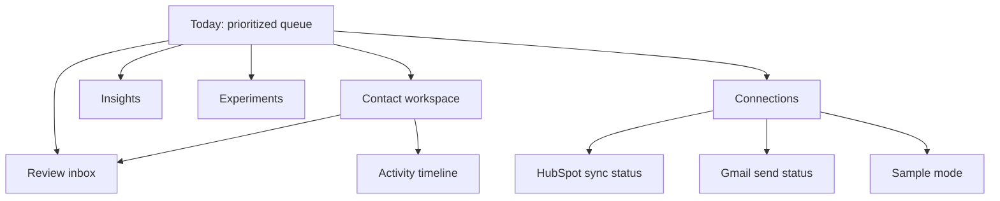
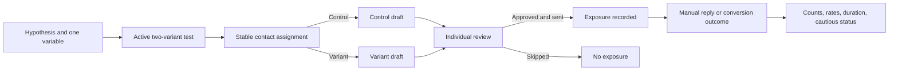
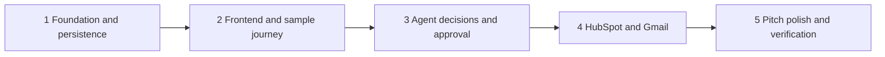

# CRM Outreach Copilot — Visual Plan

These diagrams describe the planned product in [PRODUCT_PLAN.md](PRODUCT_PLAN.md). They show the target architecture and workflows, not functionality already present in the current Streamlit demo. Mermaid diagrams render in GitHub and other Mermaid-compatible Markdown viewers.

## 1. User journey

## 2. Agent workflow and human approval

The rule check is deterministic and overrides the model. A separate idempotency record protects the external send if a workflow resumes or a user clicks twice.

## 3. System architecture

The browser receives records and connection status through the API. OAuth tokens stay encrypted on the backend. The sample path requires no HubSpot, Gmail, or Groq credentials; it uses seeded recommendations and drafts where needed for a reliable pitch demo.

## 4. Data flow and ownership

HubSpot fields are read-only in the first release. Local follow-up dates, manual reply status, drafts, approvals, and send results live in the app database. A CSV export lets users take the local records out.

## 5. Screen map

The default pitch route is **Sample mode → Today → Contact → Review → Simulated send → Activity**. The connected route uses the same screens and replaces seeded records and simulated sending with HubSpot and Gmail.

## 6. A/B message testing

Sample mode labels simulated sends and uses seeded outcomes. The results screen never declares a winner from a tiny sample.

## 7. Delivery milestones

